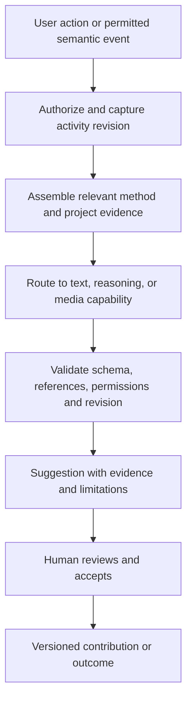

# Generative AI strategy for Design Thinking Workspace

Date: 24 September 2026  
Status: accepted later-stage product direction; core web application comes first. No model provider or AI feature is implemented yet.

Companion research: [AI_CO_DESIGN_PRACTICE_REVIEW.md](./AI_CO_DESIGN_PRACTICE_REVIEW.md), covering recent 2024–2026 practice, research, governance standards and mixed-consent workshop design.

## 1. Product position

The workspace should help individuals and teams turn research into defensible decisions and testable experiments. Generative AI adds method-aware guidance, evidence-linked synthesis, alternative exploration, and continuity between iterations. The shared canvas remains the place where people contribute and decide.

The user has requested an explicit strategy for model capabilities, agent behavior, method-specific assistance, background processing, and UI placement. This document proposes that strategy. It revisits the original blanket deferral of AI synthesis without silently changing the approved implementation scope.

Methodology continues to derive exclusively from the two supplied design-thinking books. External sources below inform AI engineering and interaction risks, not a replacement design-thinking framework. Author reviewed, original method guidance with existing book/page metadata; do not deploy the source PDFs or assume possession permits uploading them to a provider or training on them.

The central product claim to validate is: teams can explain what evidence informed a framing, what alternatives they considered, why they chose a concept, and what subsequent testing changed. Producing more notes is not a sufficient success measure.

AI is optional at project, activity and contribution level. The non-AI workflow remains complete. Teams select an explicit participation mode—AI-free, on-demand, facilitated assist or active co-design—and can always make an activity more restrictive. A participant may exclude their contributions from model processing without losing access to the human collaboration workflow.

## 2. Distinguish models, roles, and agents

“NLM” is interpreted here as the user's reference to language/neural models, especially LLMs.

- A general instruction-following language model can explain a method, rephrase a contribution, draft questions, or summarize a small selection.
- A reasoning-capable model, or a higher reasoning setting of the same model, is a candidate for conflicting evidence, framing alternatives, criteria-based comparison, and experiment design. More computation does not guarantee factual accuracy.
- A vision-language model can interpret supplied sketches, photographs, and screenshots. Structured board records should be read directly rather than reconstructed from screenshots.
- Embedding models and optional rerankers help retrieve related evidence. These support the system; they are not generators and semantic similarity does not establish truth.
- Image generation supports storyboards and prototype alternatives. Speech recognition can later convert consented recordings into timestamped draft transcripts. Neither is necessarily an LLM, and both need their own evaluation.
- A mixture-of-experts model is an internal neural-network architecture. Its experts are not inherently the app's Researcher, Facilitator, or Critic. A model can be both MoE and reasoning-capable. [Mistral's architecture explanation](https://mistral.ai/news/mixtral-of-experts/).
- An agent is the surrounding software that uses a model, context, and tools to carry out a task. Application-level expert roles can share a model and differ in instructions, allowed tools, context, and output schemas.

Recommendation: one user-facing assistant, a controlled workflow service, and a small set of capability routes. Begin with a fast text route and a deeper analysis route; they can use two models or one model with appropriate settings. Add retrieval, vision, and generation only where needed. Do not train a custom model or build an autonomous multi-agent group for the first release. Fixed, testable routing fits the initial action catalogue; dynamic delegation is a later option for demonstrably complex work. [Workflow and agent distinctions](https://www.anthropic.com/engineering/building-effective-agents).

## 3. Method-specific assistance across the cycle

| Stage and method | Individual assistance | Team assistance | Likely route | Boundary |
|---|---|---|---|---|
| Understand: problem statement, stakeholder map | Clarify scope; expose an assumption; propose interview questions | Identify conflicting definitions of success or missing stakeholder perspectives | Fast text; reasoning for conflicts | Proposed stakeholders remain hypotheses until verified |
| Observe: interview, empathy map, journey | Separate a quote from interpretation; suggest a neutral follow-up; classify a selected note | Propose evidence-linked themes, preserve exceptions, highlight gaps in coverage | Retrieval + text; reasoning for synthesis; vision/audio later | Never invent an interview, quote, action, thought, or emotion as observed fact |
| Define point of view: insight cards, How might we | Draft an insight with evidence and limitations | Compare alternative framings, identify unsupported claims and counterevidence | Retrieval + reasoning | A popular theme is not necessarily a valid insight; show conflicting sources |
| Ideate: brainwriting, dot voting | Optional prompts, analogies, or alternative mechanisms after the person has tried | Broaden neglected directions; identify near-duplicates; critique against explicit constraints | Text generation; reasoning for critique | Separate divergence from evaluation; AI does not vote or decide |
| Prototype: storyboard, prototype to test | Draft scenarios, storyboard captions, wireframe descriptions | Translate a selected concept into a prototype brief with an explicit learning objective | Text; image generation; vision review; sandboxed code later | Polish and plausibility are not validation; generated artifacts are labelled |
| Test: testing sheet, feedback capture grid | Draft neutral tasks and questions | Link observations to prototype versions, compare expected and observed results, flag ambiguity | Text + retrieval + reasoning | Simulated feedback cannot substitute for tests with people; do not claim statistical evidence from unsupported summaries |
| Reflect: I like / I wish / I wonder | Summarize personal learning and unresolved questions | Compare checkpoints, retain dissent, draft decisions and next experiments | Retrieval + reasoning; fast text for report writing | Team owns conclusions; closed history is never rewritten |

Each method needs its own AI contract: purpose, eligible activity states, allowed actions, required context, prohibited inferences, output schema, and evaluation examples. Reuse the existing activity template and blueprint versions. A generic stage prompt is insufficient: an empathy map should preserve observation versus inference; a How might we activity should offer framing alternatives; dot voting should count votes in normal code.

For an individual, the assistant acts as a coach and drafting aid. In a team it acts as a shared synthesis and review aid under facilitation controls. Personal assistance need not be broadcast, but genuinely private drafts require storage, permission, and retention controls before the UI can promise privacy. Shared outputs identify AI origin and the human who accepted them. Assistance never confers facilitator permissions on participants or editing rights on observers.

Recent professional practice does not show one preferred level of AI involvement. A NASA design-team study observed intimate co-design, selective delegation and minimal use as distinct working strategies. The product therefore treats AI involvement as a negotiated method setting rather than a maturity ladder. See the companion review for evidence and citations.

## 4. Agent roles without agent sprawl

Use these as bounded functions, not six autonomous personalities:

| Role | Responsibility | Typical output |
|---|---|---|
| Method coach | Explain the active method using reviewed guidance | Short explanation, reference, useful next question |
| Evidence analyst | Organize supplied observations and identify exceptions | Candidate theme, source references, uncertainty |
| Ideation partner | Generate distinct directions within constraints | Alternatives and the mechanism that differentiates each |
| Critical reviewer | Challenge a framing or concept against explicit criteria | Counterevidence, tradeoffs, unanswered questions |
| Prototype/test assistant | Translate an idea into something testable | Artifact brief, test task, expected learning |
| Iteration recorder | Compare accepted records and preserve rationale | Draft learning summary and proposed next actions |

The router selects by requested action, method, material type, context size, sensitivity, and budget. Stage alone does not determine the model. Rephrasing a Test note uses the fast route; reconciling contradictory Understand notes may need the reasoning route. For difficult reviews, a bounded second pass can challenge a draft, but two models agreeing is not independent evidence. Cap calls and retries; no open-ended agent debate.

## 5. Background processing and data flow

The AI service sits alongside the collaboration service, outside the editor's critical save path. Provider credentials remain on the server. Persist semantic records with stable contribution IDs; connect those records to canvas elements and Participate cards. Existing region, text, author, and timestamp fields are a start, but evidence kind, source span, and revision must be added before trustworthy synthesis.

Context is a scoped package: project brief, active method and blueprint version, selected contributions or activity snapshot, linked research, and relevant accepted decisions. Do not resend the entire board or project by default. For the first small boards, explicit source selection can precede a vector database. As archives grow, combine permission-filtered keyword and embedding retrieval and evaluate what is missed. [Retrieval engineering reference](https://www.anthropic.com/engineering/contextual-retrieval).

Keep three separate information sources: reviewed method guidance, human research evidence, and project decisions/history. Generated interpretations must not silently re-enter the evidence collection as human observations. Every derived claim should retain its path back to original evidence, including when an accepted summary is reused later.

After project-level AI configuration, background jobs may index committed notes, invalidate outdated suggestions, and prepare small, dismissible review notices. Use coalesced semantic events, not every keystroke or pointer movement. Expensive synthesis should initially run on request or at an explicitly enabled checkpoint. Cache only within appropriate permission boundaries; include source revision, method version, prompt version, and route in cache keys. Deduplicate equivalent jobs and cancel obsolete work.

Automatic behavior prepares suggestions; it does not reorganize a live board, change a blueprint, cast votes, advance a stage, close an iteration, or send communications. Users review a preview before applying a suggestion to shared records. Apply via existing server permissions and revision checks. If the board has changed, revalidate or mark stale rather than overwriting newer work. AI failures must not block editing, saving, or facilitation.

## 6. UI placement

| Surface | Proposed interaction |
|---|---|
| Desktop activity inspector | Add **Assist** beside Guide, Outcome, and Comments. Show method-specific actions, scope, pending jobs, and suggestion cards |
| Selected contribution or group | Context actions such as Clarify wording, Identify assumptions, Suggest themes, or Find related evidence; show exactly what is selected |
| Board | Only accepted suggestions become normal board objects, retaining provenance. Proposed clusters appear in a review preview before application |
| Phone/tablet Participate view | Labelled Assist action opens a sheet; cards and evidence are readable without canvas navigation. Preserve the contribution draft when opening and closing assistance |
| Review/checkpoint | Offer Draft synthesis, Review assumptions, and Compare with previous checkpoint. Preserve dissent and distinguish a checkpoint from an iteration |
| Project overview | A compact learning summary: accepted insights, unresolved questions, and latest test results, each linked to source activity/version |
| Facilitator controls | Enable or pause shared AI suggestions; choose human-first ideation; set project limits and background processing policy |
| Activity header and preflight | Show AI-free, On-demand, Facilitated or Active mode; explain purpose, eligible inputs, timing, provider/retention summary and current participant acknowledgements |
| Contribution provenance | Let a contributor mark an item Do not use with AI; preserve that restriction through retrieval, inference, caching and derived summaries |

A suggestion card includes: what is proposed, why it may help, source links, missing/contradictory evidence, AI-origin label, source revision/time, and Review/Edit/Add/Dismiss actions as appropriate. Show statuses such as Supported by cited observations, Interpretation, Hypothesis, and Needs more evidence. Do not present an invented numeric confidence score. Technical execution details and model identifiers belong in an expandable activity record, not primary workshop controls.

Example, entirely illustrative: three actual notes describe uncertainty about what happens after form submission; one describes satisfaction. The assistant proposes a theme about next-step visibility, links all supporting notes, and includes the exception. It can suggest a question to test. It cannot convert that into “users distrust the service” without labelling the inference and its evidential gap. The team can accept the theme while rejecting the proposed interpretation.

Avoid a continuously talking assistant or a wall of new AI notes. For ideation, offer human-first contribution followed by optional AI expansion and a separate review step. This is a product hypothesis informed by research: a 60-person study of image-assisted ideation found increased fixation in its experimental setting, which is a reason to test timing, not proof that all AI ideation is harmful. [Primary research](https://arxiv.org/abs/2403.11164).

## 7. Implementation contract

Proposed additions, not implemented schema:

- `MethodAIContract`: template/version, actions, eligible states, input requirements, output schema, allowed tools, evaluation examples.
- `EvidenceReference`: project, source/contribution ID, source revision, exact span or media timestamp, origin type, access policy.
- `AIRun`: requester, authorized project/activity scope, input revision/hash, contract/prompt/model version, route, status, usage, latency, retention policy.
- `AISuggestion`: run, typed output, evidence references, limitations, source revision, state (pending/accepted/dismissed/stale), acceptance actor/time, created record IDs.
- `ProjectAIPolicy`: enabled routes, approved provider/data destination, budget, retention, permitted background triggers, facilitator controls.
- `ActivityAIParticipation`: mode, purpose, timing, permitted inputs, initiative rules, acknowledgements, changedBy/changedAt.
- `ContributionAIPolicy`: AI processing allowed/denied, setBy/setAt, inherited restrictions and deletion status.

Use structured outputs and server-side validation. Check referenced IDs and quoted spans against authorized inputs. Citation presence does not prove that a source supports a claim: evaluate entailment and let users inspect the source. Treat imported notes and attachments as untrusted data, never as instructions granting access or enabling tools. AI tools are allowlisted and scoped to the user's role.

Configure retention, redaction, and provider data use before sending real research. Deletion must cover source-derived embeddings and caches as well as primary records, within the project's documented policy. Do not index another project's data merely because the same user belongs to both. Do not infer participant competence, emotional state, or contribution value from activity telemetry. Summaries preserve minority views; voting and facilitation authority remain human.

## 8. Delivery sequence

1. **Foundation:** stabilize the runnable app, semantic contribution model, durable persistence, permissions, and revision handling. Define reviewed method contracts and small representative evaluation sets. Infrastructure can proceed alongside read-only UX design for Assist.
2. **First AI slice:** empathy-map assistance over user-selected notes: explain the method, propose evidence-linked themes, identify unmarked assumptions, draft follow-up questions. One provider, fast/deep capability routes, no autonomous board mutations. Use explicit references before adding broad retrieval infrastructure.
3. **Continuity:** accepted themes feed reviewed insight cards and How might we candidates; add source links, checkpoint synthesis, and previous-iteration comparison. This tests the distinctive learning-history value.
4. **Creative/media extension:** human-first ideation support, storyboard generation, sketch interpretation, then consented transcription if demand supports it. Evaluate each media route separately.
5. **Selective agent autonomy:** only if user studies demonstrate value, allow bounded planning of multi-step analyses with fixed budgets and previewed outputs. Custom training and multi-provider fan-out need measured benefits before investment.

The first useful vertical journey is Observe → reviewed insight → framing candidate → next test question. It demonstrates more than isolated summarization while reusing the existing empathy-map focus. This proposal introduces simple evidence references in the AI slice; it does not commit to the previously deferred full automatic object-level evidence graph.

### Bring your own key and LLM pilot profiles

Users may connect their own supported model-provider key. BYOK is an access and billing option, not permission to bypass project AI policy, participant exclusions or method contracts.

- Submit the key once over TLS to an authenticated server endpoint. Encrypt it immediately in a managed secrets service or envelope-encrypted vault and return only an opaque connection ID.
- Never persist a raw key in browser local storage, IndexedDB, client state snapshots, analytics, logs, exports or collaboration messages. Never show it again after submission.
- Default to a personal connection usable only for requests initiated by its owner. A deliberately shared team connection has an owner, allowed projects/roles, budgets, audit records and immediate revocation.
- Test a new connection using provider/model metadata without sending project content. Record a masked fingerprint, validation time and status.
- Route all calls through a server gateway that checks membership, role, project and activity policy, participation acknowledgement, contribution exclusions, budget and rate limits before resolving the secret.
- Redact provider errors and operational telemetry. Model tools are allowlisted; the model receives no raw database, filesystem or arbitrary-network access.
- Support rotation and revocation. Revocation cancels or prevents new runs and background jobs while retaining non-secret provenance for completed work.
- Disable arbitrary custom endpoints initially. Later self-hosted or compatible endpoints require an administrator allowlist, TLS and network controls.

An LLM pilot profile binds a provider connection and model identifier to capabilities, reasoning settings, method actions, context/output limits, budget, data-handling notes, an evaluation-set version and a lifecycle state. The lifecycle is `draft → evaluation → approved`, with `paused` and `retired` available at any time. Any material change to model, system contract or reasoning configuration creates a new profile version. Only approved profiles can be selected for normal shared activities.

The connection owner can see provider usage attributed to the app, but cost shown by the app is an estimate unless the provider exposes authoritative billing data. The provider account remains the source of truth for charges.

## 9. Evaluation and model procurement

Choose providers and pinned models using the same local benchmark tasks, not architectural labels. Compare fast and reasoning settings on evidence fidelity, missed counterexamples, method adherence, output validity, useful diversity, latency, cost, and data-handling requirements. Evaluate at least: rephrasing without changing meaning; a sparse empathy map; contradictory observations; repetitive ideas; misleading attachment instructions; deleted sources; changed permissions; a stale activity revision; and a failed provider call.

Reasoning is a capability to allocate deliberately: deeper analysis consumes additional computation and may increase latency/cost. Provider documentation describes configuration, but app-specific gains must be measured. [Reasoning configuration reference](https://platform.claude.com/docs/en/build-with-claude/extended-thinking).

Track cost per completed activity and per accepted useful suggestion, not just token price. Set per-request and per-project limits; bound context and retries. A budget exhaustion state should explain what remains available while leaving ordinary collaboration usable. Avoid procurement claims or pricing estimates until candidates, expected workshop volume, hosting, and data policy are known.

Suggested acceptance gates:

- All emitted source references resolve to inputs authorized for that run; exact quotes match source spans.
- No fabricated research, cross-project leakage, unauthorized write, or lost participant edit in the curated release tests.
- A facilitator reviews unsupported assertions and missing counterevidence on representative outputs before release; passing a test set is not a guarantee of production correctness.
- Compare workshops with and without assistance for time to a useful synthesis, ability to trace decisions to evidence, preservation of dissent, and facilitator workload.
- Measure distinct useful ideas and premature fixation, not raw generated idea counts or acceptance rate alone.
- Establish latency and cost targets from measured candidate runs before committing them as product promises.

## 10. Repository inspection and next decision

Superseded inspection note: an earlier audit reported that `src/main.tsx` was absent. The application entry now exists and integrates the Excalidraw Board, touch-first Participate view, Review view, schema-v2 local persistence, checkpoints, semantic events, role preview, and blueprint domain model. `npm run build` and browser verification pass; contribution persistence across a fresh tab and observer read-only behavior were checked. Real phone/device testing, authenticated multiplayer, and server persistence remain unverified. No AI service or configured model integration exists.

The agreed sequence is to finish the core web application, then implement the participation controls and secure BYOK/LLM pilot foundation, followed by an evidence-linked empathy-map slice. Initial provider allowlist, secret-management service, budgets, deployment jurisdiction and research-data policy remain open until the server platform is chosen. No purchase, external data upload, AI implementation or deployment is included in this documentation update.
